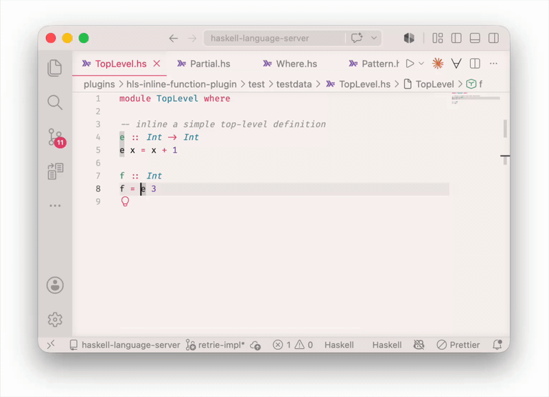

# Retrie plugin for the [Haskell Language Server](https://github.com/haskell/haskell-language-server#readme)

This plugin uses the [retrie](https://github.com/xich/retrie) library to apply source-to-source transformations across the workspace.

The following transformations are currently provided:
* Unfold replaces every usage of a function with it's body
* Inline a single usage with the function's body
* Fold replaces any instance of a function's body with a call to that function
* Apply a type synonym (forwards, or backwards)
* Apply a rule (forwards, or backwards)
<!--* Apply a pattern synonym (forwards, or backwards)-->



### What's supported
* Inlining of top-level definitions, infix operators and sections
* Inlining of let and where bindings
* Patterns in the definitions arguments
* Bindings in the expression are renamed to avoid capture
* Where bindings in the definition are rewritten as let bindings in the rewrite
* Definitions with multiple clauses are dispatched with a case statement
* Use sites that are not fully applied get lambdas inserted
* Cross-module support (including adding of imports)
<!--* Capture avoidence (including from binders introduced by RecordWildCards dots)-->
<!--* Guards are handled by inserting a case statement-->
<!--* Removal of the definition after inlining-->

### Currently unsupported scenarios
* We do not emit changes for non-active CPP branches
* Visible type application
* Recursive functions
* Functions that reference a type variable in the expression
* Cross-module inlining where the target module is missing a language pragma
* Type constraints solved by the expressions signature are not propagated to the inlining site
* Duplication of arguments (inlining could cause an argument to be evaluated multiple times)
* Capture avoidance outside of the substitution (if a binder somewhere on the path to the splice point captures a free variable in the template, we reject the inline). When tested on real code this case happens so infrequently that it’s not worth the extra effort to support.
* Rewrites into CPP modules have incorrect indentation (see https://github.com/xich/retrie/issues/24)

<!--## Dispatch

Where possible we will replace the usage site with the body of the definition.
In some cases we cannot easily determine which clause to substitute, so in these cases we generate a case statement that preserves semantics.
For example, inlining the expression `e` into `f` gives:

```haskell
module MultiClause where

e :: Int -> Int
e 0 = 0
e n = n

f :: Int
f = e 5
```

```haskell
module MultiClause where

e :: Int -> Int
e 0 = 0
e n = n

f :: Int
f = case 5 of
  0 -> 0
  n -> n
```
-->
